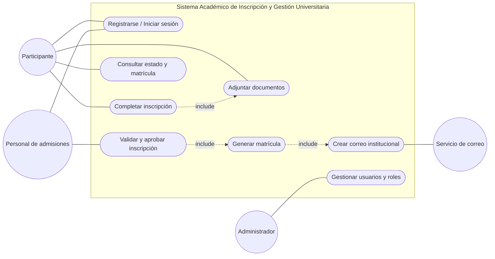
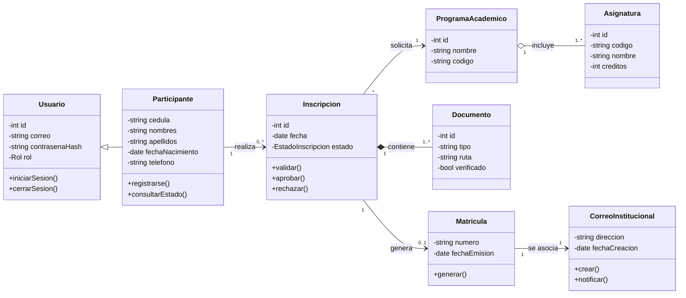
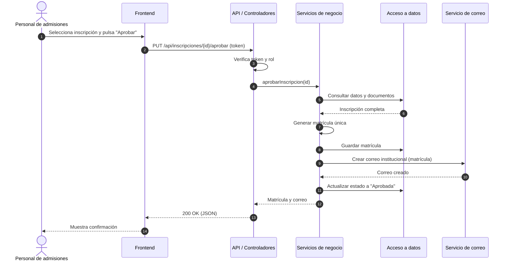
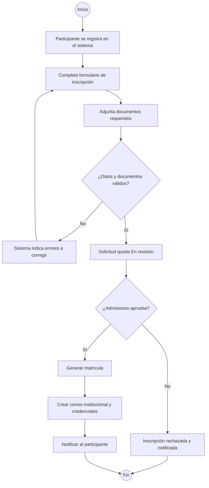

# Modelos UML

Los diagramas de componentes se elaboraron en **Visual Paradigm Online** (ver [03-arquitectura.md](03-arquitectura.md)). A continuación se incluyen los diagramas de casos de uso, clases, secuencia y actividad en Mermaid para que puedan visualizarse directamente en GitHub.

## 1. Diagrama de casos de uso

Representa el alcance funcional del sistema: qué puede hacer cada actor.

## 2. Diagrama de clases

Describe las entidades del dominio. Coinciden con las entidades de la base de datos definidas en el diagrama de componentes: usuarios, estudiantes, asignaturas, inscripciones y matrículas.

## 3. Diagrama de secuencia – Aprobación de inscripción

## 4. Diagrama de actividad – Proceso de inscripción

