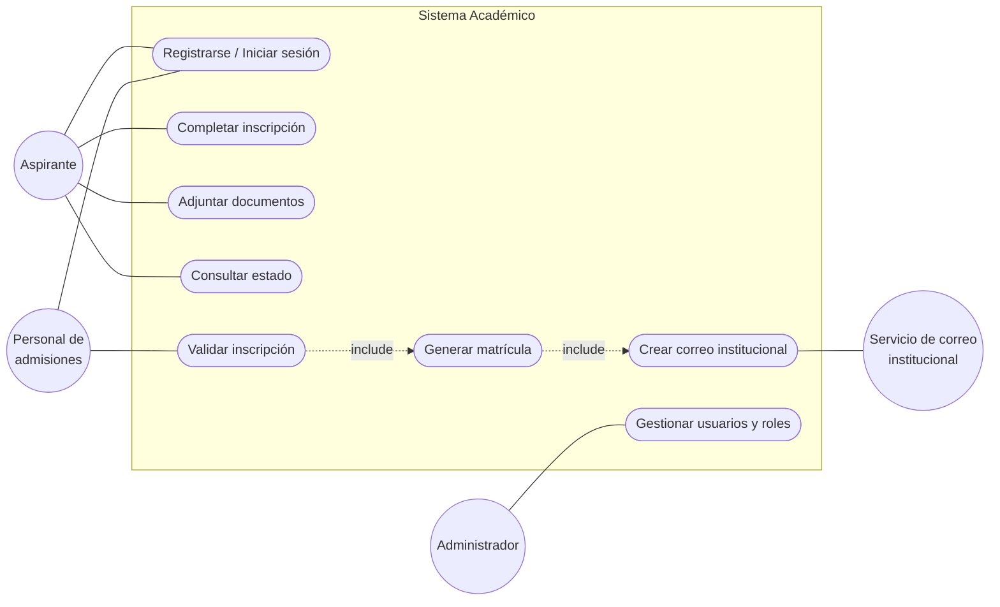
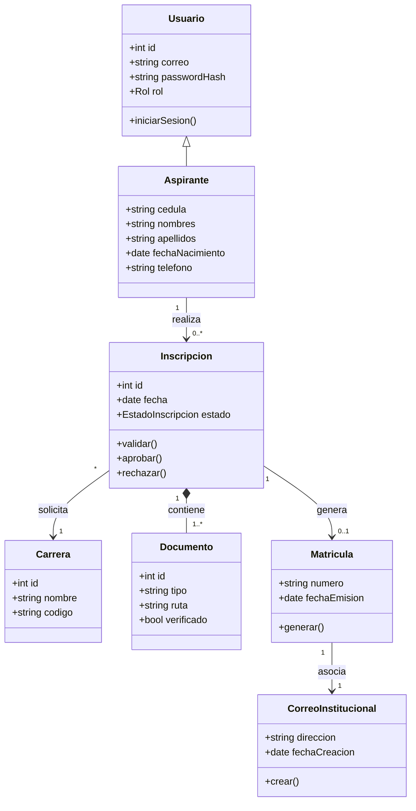
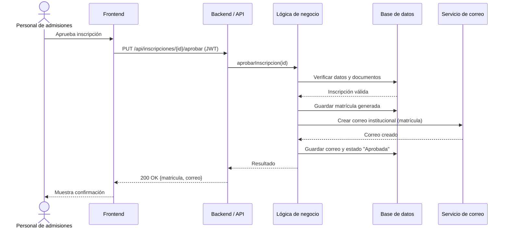
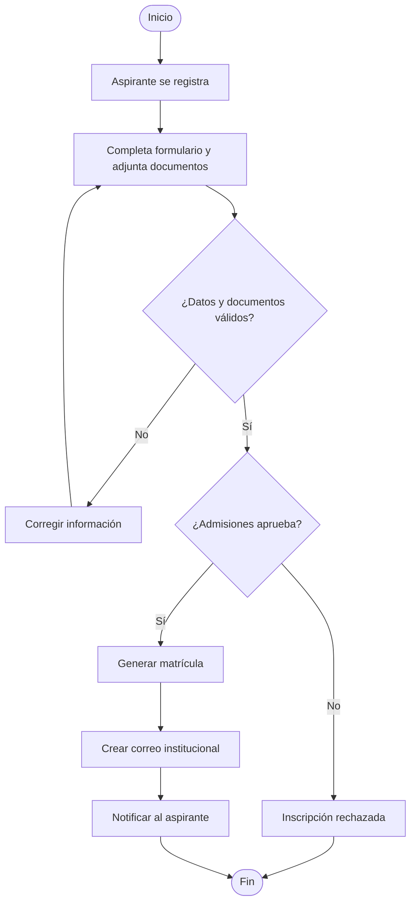

# Modelos UML

Los diagramas originales se elaboraron en **Visual Paradigm Online**. A continuación se incluye su representación en Mermaid para que puedan visualizarse directamente en GitHub.

## 1. Diagrama de casos de uso

## 2. Diagrama de clases

## 3. Diagrama de secuencia – Aprobación de inscripción

## 4. Diagrama de actividad – Proceso de inscripción

