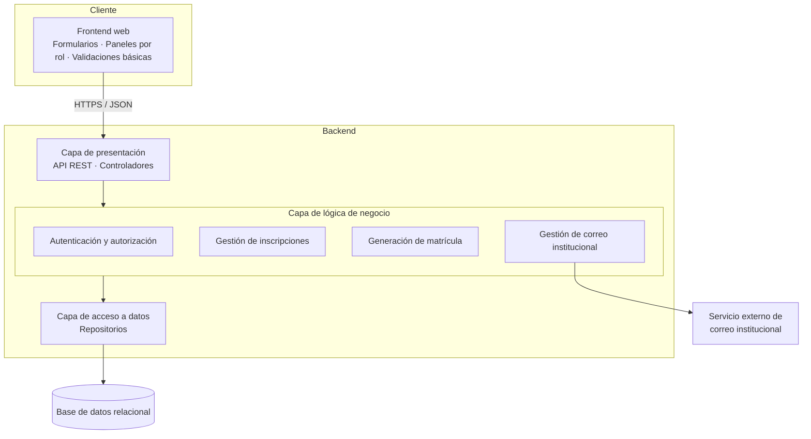

# Arquitectura del sistema

## Estilo arquitectónico

**Cliente-servidor con separación Frontend / Backend**, con el Backend organizado **por capas**. Decisión registrada en los issues [#1](https://github.com/raas03/SistemaAcademico/issues/1) y [#12](https://github.com/raas03/SistemaAcademico/issues/12).

## Componentes

| Componente | Responsabilidad |
|---|---|
| Frontend | Interacción con el usuario, formularios y presentación de resultados. |
| Capa de presentación (API) | Recibir peticiones, validar el token y delegar en la lógica de negocio. |
| Autenticación y autorización | Inicio de sesión, emisión de tokens JWT y control por roles. |
| Gestión de inscripciones | Registro, validación, aprobación o rechazo de solicitudes. |
| Generación de matrícula | Crear una matrícula única después de validar la inscripción. |
| Gestión de correo institucional | Solicitar al servicio externo la creación del correo usando la matrícula. |
| Capa de acceso a datos | Operaciones de lectura/escritura sobre la base de datos. |
| Base de datos | Persistencia de usuarios, aspirantes, inscripciones, documentos, matrículas y correos. |

## Decisiones y justificación

| Decisión | Justificación |
|---|---|
| Separar Frontend y Backend | Permite que la interfaz y el servidor evolucionen y se desplieguen de forma independiente. |
| Backend por capas | Aplica separación de responsabilidades y facilita pruebas y mantenimiento. |
| API REST + JSON | Estándar ampliamente soportado, sencillo de consumir desde cualquier cliente. |
| JWT | Autenticación sin estado, adecuada para APIs. |
| Matrícula antes del correo | El correo institucional depende de la matrícula, por eso se crea después de validar la inscripción. |

## Limitaciones

- Mayor complejidad inicial frente a una aplicación monolítica simple.
- Dependencia del servicio externo de correo institucional (si falla, la inscripción queda pendiente de correo).
- Requiere definir bien el contrato de la API entre Frontend y Backend.

## Diagramas originales (Visual Paradigm Online)

- [Diagrama de componentes](https://online.visual-paradigm.com/app/diagrams/#diagram:workspace=twpyqszp&proj=0&id=1&type=ComponentDiagram&width=11&height=8.5&unit=inch)
- [Vista de arquitectura de aplicación (ArchiMate)](https://online.visual-paradigm.com/app/diagrams/#diagram:proj=0&type=ArchiMateDiagram&gallery=/repository/ec6b795c-8128-4ec4-8e8a-78cf193562ce.xml&name=Application%20Architecture%20View)
